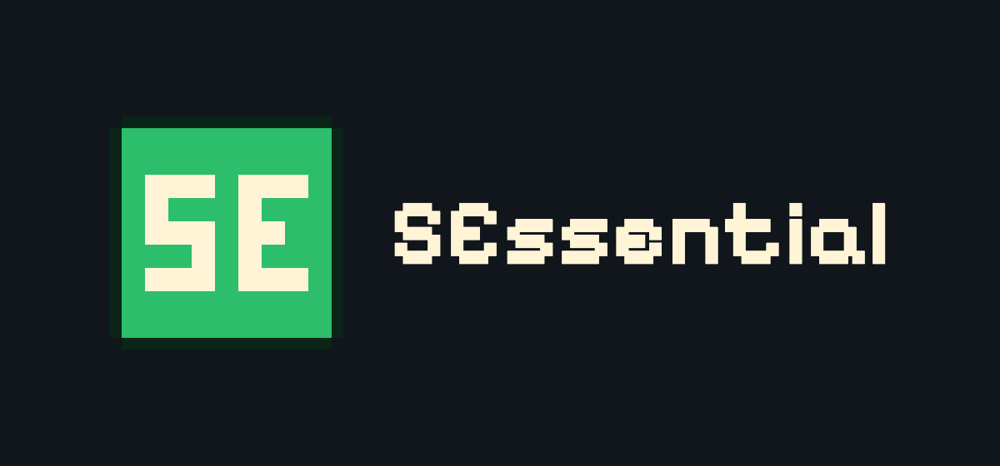

**An all-in-one server toolkit for Paper 26.2 / 26.3** — chat, TAB, moderation, economy, clans, an admin panel and much more in a single plugin. Every module can be turned on or off, and every message supports MiniMessage and `&` color codes.

> **Beta:** 1.3.0-beta.1 is a beta release. Please back up your server and report bugs before using it in production.

## Features

**Chat & display**
- Chat format per LuckPerms group
- **LuckPerms auto-setup:** `/sessentials lpsetup` creates a ready-made group ladder (default → vip → supporter → moderator → admin) with colored prefixes, weights, inheritance and the plugin permissions — preview first, nothing is ever deleted
- TAB list (header/footer, names) and sorted nametags
- Configurable join and leave messages
- Clickable, configurable `/help` pages
- Server rules (`/rules`) with mandatory acceptance, versions and an in-game editor
- Custom command aliases that run one or more commands

**Players**
- `/fly`, `/heal`, `/feed`, `/god`, `/enderchest`
- `/msg` and `/r` private messages, `/mail` for offline players
- `/tpa` teleport requests, `/spawn` and `/setspawn`, `/nether` and `/end` — with optional costs (money or items) and teleport delays
- Per-player time and weather: `/ptime`, `/pweather`
- Custom prefixes and suffixes: `/prefix <text> [player] [time]`, `/suffix …` — shown in chat, TAB and nametags, optionally temporary, **works without LuckPerms**
- Floating dragon egg: after the dragon fight the egg hovers over the portal with a live player counter — it can only be collected by a player who is **alone** in a configurable range
- Disposable elytras: jump off a cliff inside a launch area and get a temporary elytra that disappears on landing — locked in the chest slot, with a **boost on F**
- Separate inventories for Creative and Survival: `/gminv`
- Durability warning for armor, tools and weapons (`/durability`)

**Economy**
- Digital bank: deposit items, pay with your account, `/pay` — optionally provided as a **Vault** economy
- Chest shops: buy and sell items from chests
- Bounties: put money on a player; whoever kills the target gets the bounty and the inventory
- Item upgrader: risk an item for a chance at a more valuable one
- Wheel of fortune (in-game currency only) with a server pot fed by fees and server payments

**Clans**
- Create clans with a color, invitations, clan home by vote, shared chest and clan bank

**Moderation**
- Vanish with protection rules, fake join/leave messages and an adjusted server list
- Punishments: bans, mutes, IP bans — free-form or from templates, temporary or permanent
- Report system (`/report`) with an admin overview
- Fairplay: score leaderboard, combat-log, spawn-kill and kill-farming detection, strikes with automatic punishment
- ItemGuard: removes forbidden items and spawn eggs and reports them
- CreativeLog: logs actions in Creative mode
- Item tracker: tracks valuable items in inventories and ender chests, with history
- Client detector: recognizes vanilla, modded and known hacked clients on join
- Trust: new players can't interact with the world until enough players vouch for them (or after enough playtime), plus an optional suspicion vote that bans a player once enough players vote
- Social spy (`/socialspy`) and `/sudo`

**Administration**
- `/admin` panel as a central menu for all modules
- Web panel with statistics in the browser (login via one-time link from `/webpanel`)
- News system with scheduling and duration
- Soft restart with countdown, boss bar and title
- Fake players (`/fakeplayer`): players without a client that load chunks, can wander, fight or mine — or be controlled by an admin
- Optional auto-update from GitHub releases (off by default)

## Requirements
- Paper **26.2 or 26.3**, Java **25**
- Optional: **LuckPerms** (prefixes, suffixes, groups — custom prefixes/suffixes also work without it), **PlaceholderAPI**, **Vault**

## Installation
1. Put `SEssentials-<version>.jar` into your `plugins/` folder and start the server.
2. Configure it in `plugins/SEssentials/`: `config.yml` (language, prefix, modules on/off), `config/<module>.yml` and `lang/<language>.yml`.
3. Languages: English (`en_US`) and German (`de_DE`) are included — set `language: en_US` and run `/sess reload`. Admin menu labels are currently German only.

New options from updates are added to your files automatically; existing values are kept.

## Permissions
Defaults: **OP** unless marked *everyone* or *nobody* (nobody = grant explicitly). Every module can be switched off in `config.yml` (`modules`).

### General & administration

| Permission | Default | Allows |
|---|---|---|
| `sess.admin` | OP | `/admin` – open the admin panel |
| `sess.reload` | OP | `/sessentials reload` |
| `sess.lpsetup` | OP | `/sessentials lpsetup` – create LuckPerms groups with prefixes and permissions |
| `sess.softrestart` | OP | `/softrestart` |
| `sess.update` | OP | `/autoupdate` and auto-update in the admin panel; receives update notices |
| `sess.webpanel` | OP | `/webpanel` – login link for the web panel |
| `sess.news.admin` | OP | `/newsadmin` – manage news, read unpublished news |
| `sess.rules.admin` | OP | `/regeladmin` – manage rules, acceptance version, rollout |
| `sess.fakeplayer` | OP | `/fakeplayer` – create, control and remove fake players |
| `sess.fakeplayer.ignore` | nobody | Not attacked by fighting fake players |
| `sess.dragonegg.admin` | OP | `/dragonegg` – place or remove a floating dragon egg |
| `sess.elytra.admin` | OP | `/elytra` – manage launch areas for disposable elytras |

### Chat & display

| Permission | Default | Allows |
|---|---|---|
| `sess.chat.color` | OP | Use `&` color codes in chat |
| `sess.chat.minimessage` | OP | Use MiniMessage tags in chat |
| `sess.prefix` | OP | `/prefix` – own prefix in chat, TAB and nametag |
| `sess.prefix.others` | OP | `/prefix` for other players, also offline |
| `sess.suffix` | OP | `/suffix` – own suffix |
| `sess.suffix.others` | OP | `/suffix` for other players, also offline |
| `sess.msg` | everyone | `/msg` and `/r` |
| `sess.mail` | everyone | `/mail` – messages to offline players |
| `sess.spy` | OP | `/socialspy` – read private messages and mails |

### Player commands

| Permission | Default | Allows |
|---|---|---|
| `sess.fly` | OP | `/fly` |
| `sess.fly.others` | OP | `/fly <player>` |
| `sess.heal` | OP | `/heal` |
| `sess.heal.others` | OP | `/heal <player>` |
| `sess.feed` | OP | `/feed` |
| `sess.feed.others` | OP | `/feed <player>` |
| `sess.god` | OP | `/god` |
| `sess.god.others` | OP | `/god <player>` |
| `sess.sudo` | OP | `/sudo` – make a player run a command or chat |
| `sess.sudo.exempt` | OP | Can't be controlled with `/sudo` by players (console still can) |
| `sess.enderchest` | everyone | `/enderchest` (`/ec`) |
| `sess.enderchest.free` | OP | `/enderchest` without cost |
| `sess.ptime` | everyone | `/ptime` – personal time |
| `sess.pweather` | everyone | `/pweather` – personal weather |
| `sess.gamemodeinv` | OP | `/gminv` – separate Creative/Survival inventories |
| `sess.durability` | everyone | Durability warning; `/durability` toggles it |
| `sess.elytra.use` | everyone | Receive a disposable elytra in launch areas |

### Teleport

| Permission | Default | Allows |
|---|---|---|
| `sess.spawn` | OP | `/spawn` without cost |
| `sess.setspawn` | OP | `/setspawn` |
| `sess.tpa` | everyone | `/tpa` |
| `sess.tpa.free` | OP | `/tpa` without cost |
| `sess.nether` | OP | `/nether` |
| `sess.end` | OP | `/end` |
| `sess.teleport.nowarmup` | OP | Teleport without delay (`/spawn`, `/tpa`, `/nether`, `/end`, `/clan home`) |

### Economy & clans

| Permission | Default | Allows |
|---|---|---|
| `sess.bank` | everyone | `/bank` – deposit, withdraw |
| `sess.bank.pay` | everyone | `/pay` |
| `sess.bank.admin` | OP | `/eco` and account management in the admin panel |
| `sess.chestshop.create` | everyone | Create chest shops |
| `sess.chestshop.admin` | OP | Create admin shops, open and break all shops |
| `sess.bounty` | everyone | `/kopfgeld` – place and view bounties |
| `sess.bounty.admin` | OP | Remove bounties, bounty management in the admin panel |
| `sess.gamble` | everyone | `/gluecksrad` – wheel of fortune |
| `sess.gamble.admin` | OP | Set the pot, wheel settings in the admin panel, per-player odds in the web panel |
| `sess.upgrader` | everyone | `/upgrader` – item upgrader |
| `sess.upgrader.admin` | OP | `/upgrader admin` – item values and blocklist |
| `sess.tracker` | OP | Item tracker in the admin panel |
| `sess.clan` | everyone | `/clan` – found, join, home, chest, clan bank |
| `sess.clan.admin` | OP | Disband clans, clan management in the admin panel, break other clans' chests |

### Moderation

| Permission | Default | Allows |
|---|---|---|
| `sess.vanish` | OP | `/vanish` |
| `sess.vanish.auto` | nobody | Vanished automatically on join |
| `sess.vanish.bypass` | OP | `/vanish bypass` – lift vanish protection rules |
| `sess.vanish.see` | OP | See vanished players |
| `sess.punish.ban` | OP | `/ban`, `/unban` and ban templates |
| `sess.punish.mute` | OP | `/mute`, `/unmute` and mute templates |
| `sess.punish.ipban` | OP | `/ipban`, `/unbanip` and IP-ban templates |
| `sess.punish.history` | OP | `/history` and punishments in the admin panel |
| `sess.punish.notify` | OP | Notified of new and lifted punishments |
| `sess.punish.exempt` | OP | Can't be punished by players (console still can) |
| `sess.report` | everyone | `/report` |
| `sess.report.notify` | OP | Notified of new reports |
| `sess.report.bypasscooldown` | OP | Ignore the `/report` cooldown |
| `sess.reports.admin` | OP | `/reports` and `/clearreports` |
| `sess.fairplay` | everyone | `/fairplay` – own points, other players, leaderboard |
| `sess.fairplay.admin` | OP | `/fairplay reset`, fairplay management, violation history |
| `sess.fairplay.notify` | OP | Notified of fairplay violations and strikes |
| `sess.fairplay.exempt` | nobody | Never gets fairplay violations |
| `sess.trust` | everyone | `/trust` (own status, vote for new players) and `/suspect` |
| `sess.trust.vote` | OP | May vote for trust/suspicion when `trust.voters` is set to `permission` |
| `sess.trust.admin` | OP | `/trust add\|remove` – set or revoke trust directly |
| `sess.trust.bypass` | OP | Always trusted |
| `sess.itemguard.scan` | OP | `/itemscan` |
| `sess.itemguard.admin` | OP | Configure ItemGuard in the admin panel |
| `sess.itemguard.bypass` | OP | Not scanned by ItemGuard |
| `sess.creativelog.view` | OP | `/creativelog` and its admin panel view |
| `sess.creativelog.bypass` | nobody | Not logged in Creative mode |
| `sess.detector.notify` | OP | Notified by the client detector |

## Good to know
- **Web panel:** disabled by default and bound to `127.0.0.1`. It speaks plain HTTP — put a reverse proxy with HTTPS (e.g. Caddy, nginx) in front of it before exposing it to the internet. It loads player avatars from mc-heads.net.
- **Auto-update:** disabled by default. If you enable it (`/autoupdate`), the plugin checks the project's GitHub releases once a day, verifies the jar (SHA-256) and installs it on the next restart. Beta releases are never installed automatically.
- **Fake players** appear in TAB and `/list` like real players. While an admin controls one, it temporarily gets that admin's permissions (including OP).
- **Wheel of fortune** is meant for in-game currency only. Selling in-game currency for real money to use on it may violate the [Minecraft Usage Guidelines](https://www.minecraft.net/usage-guidelines).
- No telemetry, no metrics, no license checks.

## Support
Report bugs and suggestions on [GitHub Issues](https://github.com/mauricebrn/SEssentials/issues).

## AI disclaimer
SEssentials is developed with the help of AI tools (Anthropic's Claude). Large parts of the code, as well as this description, were written with AI assistance. All changes are reviewed by the author before release, and the full source code is public on [GitHub](https://github.com/mauricebrn/SEssentials).

## License
MIT
